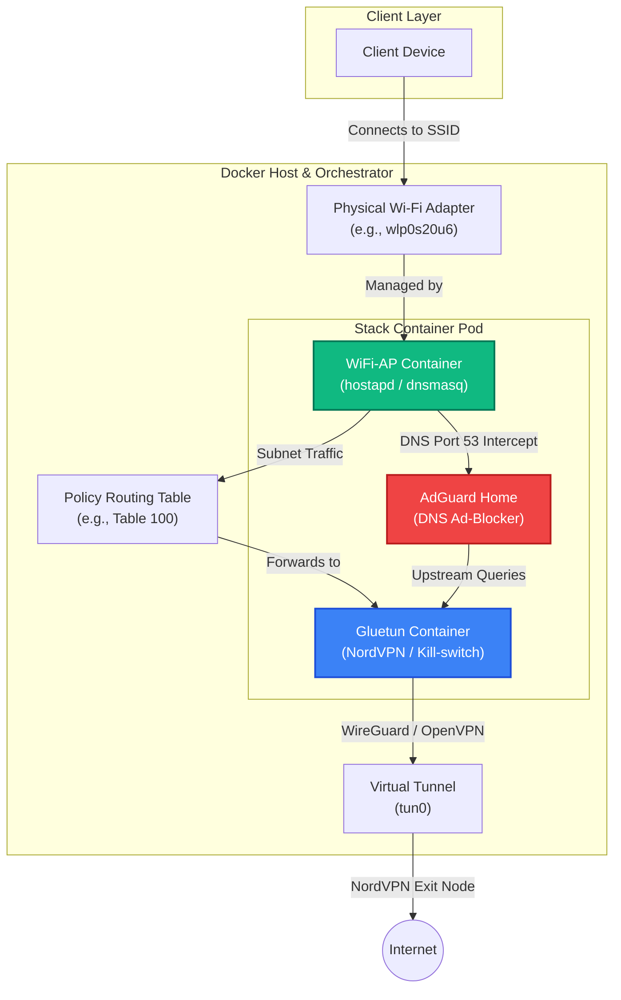
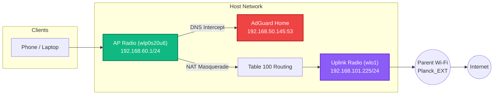

# nordvpn_ap (AP Manager)

**High-performance Rust orchestrator and modern web dashboard that turns any Linux system into isolated, NordVPN-tunneled or direct Wi-Fi access points and repeaters.**

Route Smart TVs, gaming consoles, streaming boxes, projectors, or any client device without native VPN capabilities through an encrypted NordVPN tunnel or direct NAT bridge just by connecting to a Wi-Fi hotspot.

---

## ⚡ Key Highlights

- **Dual Operating Modes**:
  - **Direct Access Point (AP Mode)**: Hotspot on a dedicated wireless interface with full-tunnel NordVPN encryption or plain NAT bridge.
  - **Wi-Fi Repeater Mode**: Uses an uplink adapter (STA) to join an upstream parent network with automated DHCP lease management, simultaneously broadcasting an isolated Hotspot on an AP interface.
- **VPN Freedom**:
  - **NordLynx (WireGuard)**: Auto-extracts private keys directly from a NordVPN access token—no manual configuration required.
  - **OpenVPN**: Full compatibility with NordVPN service credentials.
  - **Direct / Plain NAT Bridge**: Zero VPN overhead mode for high-throughput local network extension.
  - **8-Hour Auto-Reconnect**: Optional scheduled reconnection every 8 hours for tunnel freshness and exit node rotation.
- **AdGuard Home DNS Filtering**:
  - **Built-in Containerized AdGuard Home**: Spins up seamlessly inside the Gluetun network namespace.
  - **External AdGuard Home Auto-Detection**: Auto-discovers LAN AdGuard Home instances (e.g. `192.168.50.145:53`) and redirects client DNS via iptables DNAT.
  - **Port 853 DoT Interception**: Hard TCP RST reject on port 853 prevents mobile devices from bypassing AdGuard via private DNS.
- **Hardware Resilience & Auto-Healing**:
  - **Intelligent Frequency Mapping**: Prevents `hostapd` startup crashes by validating adapter band capabilities (2.4 GHz vs 5 GHz) and auto-correcting incompatible configurations.
  - **Self-Healing Watchdog**: Automatically unblocks `rfkill`, recovers crashed `hostapd` instances, restores missing IP addresses, and repairs policy routing tables.
- **Modern Glassmorphic Dashboard**:
  - Real-time WebSocket streaming (`/ws/stacks`) for live telemetry, throughput, and status.
  - Mode-aware UI: filters wireless settings and capabilities dynamically based on hardware limits.
  - Tabbed live container log viewer (WiFi-AP, Gluetun VPN, AdGuard Home).
  - Integrated wireless interface inspector and scan utility.

---

## 🏗 Architecture & Stack Topology

Each access point stack runs as an isolated set of containers wired together through dedicated Linux policy routing tables:

```
[WiFi Client] ──► [hostapd / dnsmasq AP] ──► [gluetun (NordVPN)] ──► [Internet]
                         │                         │
                         ▼                         ▼
                  [iptables DNAT]           [AdGuard Home]
                         │
                         ▼
        [External AdGuard / Local DNS]
```

### 1. Tunneled AP Flow (NordVPN + AdGuard)



### 2. Wi-Fi Repeater Mode (Bridge & Extender)

In Repeater Mode, the stack bridges traffic directly between the AP broadcast adapter and an uplink wireless interface connecting to parent Wi-Fi:



### 3. Multi-Stack Isolation

Run multiple APs side by side without collisions:
- Stack A (`vpn-us`): `wlp0s20u2` → Subnet `192.168.60.0/24` → Table `100` → NordVPN US
- Stack B (`vpn-india`): `wlp0s20u4` → Subnet `192.168.61.0/24` → Table `101` → NordVPN India
- Stack C (`repeater`): `wlp0s20u6` (AP) + `wlo1` (Uplink) → Subnet `192.168.62.0/24` → Table `102` → Direct NAT

---

## 📁 Repository Structure

```
nordvpn_ap/
├── access_point/                    # AP Container Context
│   ├── AdGuardHome.yaml             # Baseline AdGuard Home template
│   ├── Dockerfile.wifi-ap           # Debian-slim image with hostapd, dnsmasq, iptables
│   └── wifi-ap-entrypoint.sh        # Core orchestrator: unblock, STA association, routing
├── frontend/                        # Dashboard SPA (React 19 + TanStack Router + Vite)
│   ├── public/                      # Static icons and assets
│   ├── src/
│   │   ├── components/              # UI widgets (stack-form, stack-logs, vpn-shell)
│   │   ├── routes/                  # App routes (Dashboard, Credentials, Interfaces)
│   │   └── lib/                     # API client, clipboard helpers, types
│   ├── package.json
│   └── vite.config.ts               # Vite build configuration (outputs to ../static)
├── src/                             # Rust Backend Orchestrator (Axum + Tokio)
│   ├── api.rs                       # REST endpoints & WebSocket state streamer
│   ├── config.rs                    # Stack persistence & subnet/table allocation
│   ├── docker.rs                    # Compose generator & container manager
│   ├── wifi.rs                      # Wi-Fi interface auditing & signal calculations
│   └── main.rs                      # Server entrypoint & host dir auto-detection
├── static/                          # Production web assets served directly by Axum
│   ├── assets/                      # Bundled JS & CSS
│   └── index.html
├── scripts/
│   └── check-interfaces.sh          # Pre-flight hardware & environment auditor
├── docker-compose.yml               # Production deployment for AP Manager
├── Dockerfile                       # Multi-stage Rust build container
├── Cargo.toml                       # Rust crate dependencies
└── README.md
```

---

## 🚀 Quick Start

### 1. Verify Hardware Capabilities

Ensure your Wi-Fi interface supports AP mode:

```bash
# Run the included pre-flight check script
chmod +x scripts/check-interfaces.sh
./scripts/check-interfaces.sh wlo1 wlp0s20u6
```

Or manually inspect with `iw`:
```bash
iw list | grep -A 8 "Supported interface modes"   # Must include "AP"
```

### 2. Deploy AP Manager

```bash
git clone https://github.com/virajt71/nordvpn_ap.git
cd nordvpn_ap

# Start the orchestrator
docker compose up -d
```

- **Port**: Default is `42918`.
- **Host Network Mode**: `network_mode: host` and `privileged: true` allow direct interface and routing control.
- **Docker Socket**: `/var/run/docker.sock` is mounted so the orchestrator can manage its child containers.
- **Zero-Config Root**: Automatically detects `HOST_PROJECT_DIR` via Docker self-inspection.

### 3. Open the Dashboard

Navigate to:
```
http://localhost:42918/
```

### 4. Configure Credentials & Stacks

1. Navigate to **Settings → NordVPN Credentials**:
   - **NordLynx (WireGuard)**: Paste your NordVPN access token → click **Fetch Key** to automatically retrieve your private key.
   - **OpenVPN**: Enter your service username and password.
2. Click **+ New Access Point**:
   - Choose **AP Mode** (single adapter) or **Repeater Mode** (uplink + AP).
   - Select your AP wireless adapter, SSID, and password.
   - Choose your exit location or select direct NAT bridge.
   - Optionally set an external AdGuard Home DNS IP (auto-detected if present).
   - Click **Deploy Stack**.

---

## 📡 REST & WebSocket API

| Method | Endpoint | Description |
|---|---|---|
| `GET` | `/api/stacks` | List all AP profiles, state, IPs, and telemetry |
| `POST` | `/api/stacks` | Create new stack (auto-allocates subnet & routing table) |
| `GET` | `/api/stacks/:id` | Get stack configuration and live status |
| `PATCH` | `/api/stacks/:id` | Update stack settings (SSID, security, channel, etc.) |
| `DELETE` | `/api/stacks/:id` | Terminate and tear down stack containers |
| `POST` | `/api/stacks/:id/start` | Start stack containers |
| `POST` | `/api/stacks/:id/stop` | Stop stack containers |
| `POST` | `/api/stacks/:id/restart`| Restart stack containers |
| `GET` | `/api/stacks/:id/logs` | Fetch real-time container logs (WiFi-AP, Gluetun, AdGuard) |
| `GET` | `/api/credentials` | Query NordVPN credentials |
| `PATCH` | `/api/credentials` | Save / update NordVPN credentials |
| `GET` | `/api/wifi/interfaces` | List host wireless interfaces & band capabilities |
| `GET` | `/api/wifi/scan/:iface` | Scan nearby Wi-Fi networks via selected adapter |
| `GET` | `/api/dns/adguard/detect` | Auto-detect external AdGuard Home instance on host |
| `GET` | `/api/vpn/locations` | List available NordVPN countries and cities |
| `GET` | `/api/health` | Service and Docker daemon health status |
| `WS` | `/ws/stacks` | Live WebSocket stream of stack status snapshots |

---

## 🛠 Advanced Features & Recovery

### Automated Channel Self-Healing
If a 2.4 GHz-only Wi-Fi dongle (e.g. standard Realtek / MediaTek USB adapters) is assigned a 5 GHz channel (channels > 14) or VHT mode, the orchestrator detects the hardware limits and automatically falls back to **Channel 6 (20 MHz)**, avoiding `hostapd` fatal frequency errors.

### DNS & Private DNS Protection
- **Port 53 DNAT**: All outbound port 53 UDP/TCP traffic on the AP interface is redirected to the stack's configured AdGuard Home instance.
- **Port 853 Rejection**: Android and iOS devices using "Private DNS" (DNS-over-TLS) are sent immediate TCP resets on port 853, forcing them to fall back to the filtered AdGuard Home DNS.
- **Route Healing**: If using `adguard-shim`, the orchestrator ensures internet connectivity and interface default routes remain healthy.

---

## 📚 References & Credits

- [gluetun](https://github.com/qdm12/gluetun) - Secure, lightweight VPN client container for Docker.
- [hostapd](https://w1.fi/hostapd/) - IEEE 802.11 AP and IEEE 802.1X/WPA/WPA2/EAP Authenticator.
- [AdGuard Home](https://github.com/AdguardTeam/AdGuardHome) - Network-wide ads & trackers blocking DNS server.
- Foundational tunnel-sharing logic inspired by [dannypv05261/docker-vpn-ap](https://github.com/dannypv05261/docker-vpn-ap).

---

## 📄 License

MIT License. See [LICENSE](LICENSE) for details.
